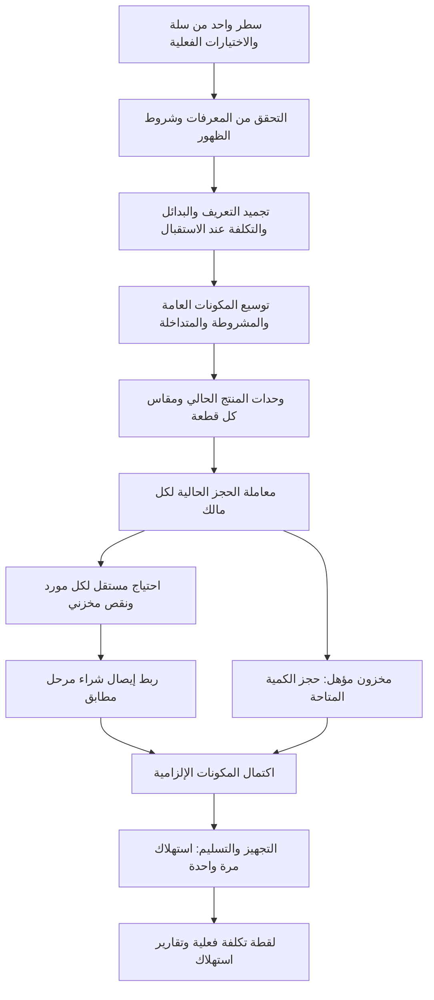
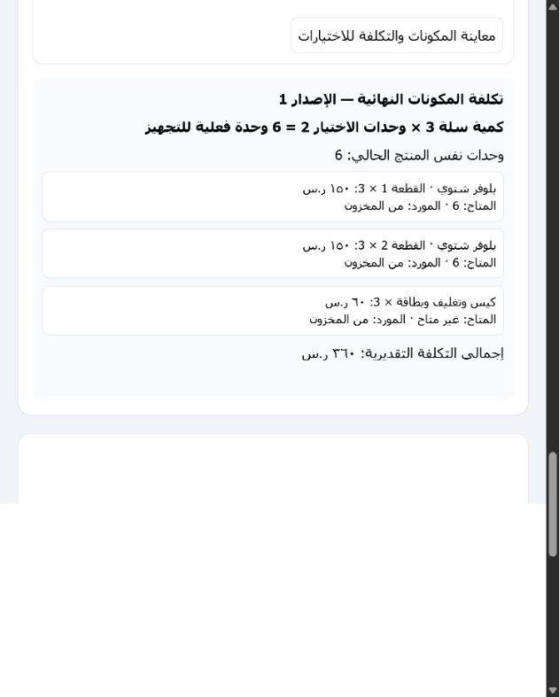
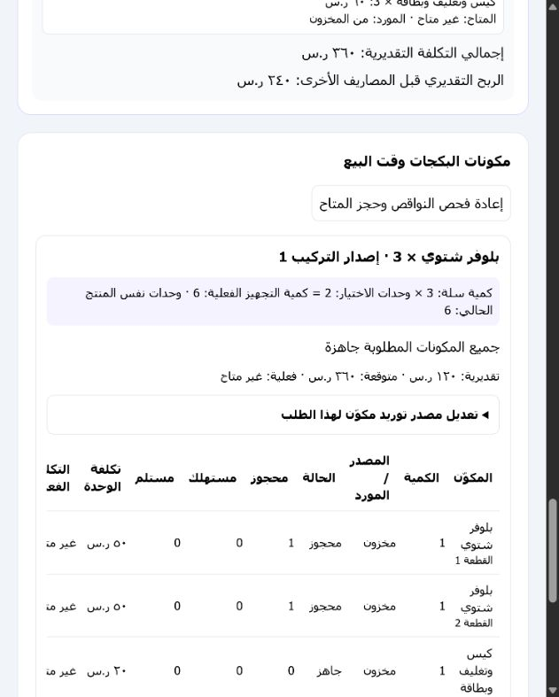
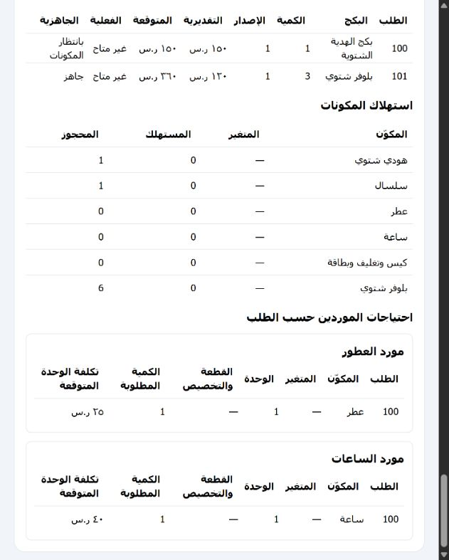

# ميزان 2 — تقرير مرشح إصدار البكجات

## تحديث النشر — 2026-10-17

اعتمد المالك النشر، ودُمج PR #1388 ونُشرت النسخة مرة واحدة. التفاصيل التالية تتقدم على حالة المسودة وعدم النشر التاريخية أدناه.

- Source A: `62f12cd70808cc41d092ded972b21c5398c55e59`.
- Intent B: `62714f303a5ab63b46c84991c33ed0c8dee451f9`.
- Production merge: `c03c9df22d07a9a99984b02ab134763b0ae600a8`.
- Runtime: `rg5-50f9dff504a9178a36e00a10e4333e6f96efde6213d2cc0c8ccde52ef81f4ef4`.
- CI readiness `38971347875` نجح قبل الدمج. نجحت إعادة البناء المحكومة داخل `/app`، ثم `prepare` و`prepublish` برمز خروج 0.
- Emergent أظهر حدثًا جديدًا أخضر `Deployment finished Oct 17, 02:11 AM` وإصدار `Publish 100 / aaf5963` بنقطة خضراء وحالة Live. واجهته الحالية لم تعرض النص الحرفي `Deployment Succeeded` المذكور في البروتوكول؛ لا ننسب إليها نصًا لم يظهر.
- `PYTHONDONTWRITEBYTECODE=1 python scripts/production_release_guard.py verify --url https://mezansalla.com`: exit 0، `verified=true`، `checks=3`، وهوية المصدر والإصدار أعلاه. شمل الفحص ملفات الواجهة وطلبات build-meta العادية والمتجاوزة للكاش.
- Frontend artifact tree: `89cc5ec23915bbd58b298ad46a8acc943769973c67e22373d1e8b2787b0839a0`.
- فحص `status` بعد التحقق: `active=false`. لا توجد رخصة نشر نشطة تخص المهمة.
- لم تُنفذ طلبات تجارية حقيقية أو كتابة إلى سلة أو الموردين كاختبار. بقيت الملفات غير المتعلقة بالمهمة محفوظة.
- هذا تحديث توثيقي بعد النشر على فرع المهمة، وليس جزءًا من هوية الإصدار المنشور. لا تُعد النشر بسبب اختلاف تسمية حالة الواجهة؛ سجل الأدلة الحالي هو المرجع للاستمرار.


تاريخ التنفيذ: 2026-10-16. الفرع: `codex/mz2-smart-bundles`، بدأ على `8c9ef8cd9` ثم أُعيد تأسيسه دون تعارض على `1674bb8b0` من فرع الإنتاج. Commit التنفيذ: `d20c44505cd9ada105ccb50a807db5a8afc36fca`. جميع بيانات الاختبار اصطناعية في قواعد محلية مؤقتة. لم يُنشر شيء إلى الإنتاج، ولم تُرسل منتجات أو مشتريات إلى سلة أو الموردين.

طلب المراجعة المسودة: [PR #1388](https://github.com/AMASI-SA/AMASI-SA/pull/1388). Commit إصلاح سياسة تغيير المصدر والأدلة: `fc64027e3c908dbadc0a8b32e2da6ac81d14a7df`.

## ما أضيف

استُخدمت منتجات Product V2 ومكونات Components V2 وخيارات العميل ومعرّفات الموردين الحالية. أضيف تعريف إصدار للبكج، وتوسّع محرك الحجز والاستهلاك الحالي ليستقبل المنتجات الفعلية والمكونات بدل حجز المنتج الأب مرة أخرى. بقي المنتج المباع سطرًا واحدًا في الطلب؛ لا توجد مبيعات داخلية إضافية ولا سجل مخزون موازٍ.

يدعم المحرك مكونات عامة ومشروطة وخيارات متعددة وشروط ظهور تتحقق في الخادم، ومنتجات متداخلة وموردًا مستقلًا لكل عنصر. نوع `current_product` يعني الوحدة الأساسية للمنتج الجاري تعديله؛ ينتهي التوسع عندها ولا يعيد استدعاء تعريف البكج. المرجع العادي من المنتج إلى نفسه يظل ربطًا دائريًا مرفوضًا.

لكل قطعة `slot_id` ومقاس ثابت أو قواعد تربط معرّفات الخيارات والقيم بمتغير موجود. يمكن ربط نص المقاس بتخصيص المورد دون اختراع Variant. نقص المقاس يمنع المعالجة، وإيصال الاستلام يجب أن يطابق المنتج والمتغير والمورد والتخصيص. يُحفظ النص داخل لقطة الطلب ولا يُستخدم اسم الخيار الظاهر كهوية مخزنية.

## الكميات والتغليف والتكلفة

`Fulfillment Quantity = Sale Quantity × Units per Selection`.

| اختيار العميل | كمية سلة | القطع الفعلية | تكلفة القطع عند 50 | تغليف 20 لكل بكج | المتوقع |
| --- | ---: | ---: | ---: | ---: | ---: |
| بلوفر واحد | 1 | 1 | 50 | 20 | 70 |
| بلوفرين | 1 | 2 | 100 | 20 | 120 |
| 3 بلوفرات | 1 | 3 | 150 | 20 | 170 |
| 4 بلوفرات | 1 | 4 | 200 | 20 | 220 |
| بلوفرين | 3 | 6 | 300 | 60 | 360 |

يحدد المالك صراحةً نطاق مكونات المنتج الأصلية عند استعمال مرجع المنتج الحالي: `per_bundle` أو `per_unit`. التغليف لا يتكرر لكل قطعة إلا عند اختيار ذلك. تداخل المكوّن الصريح مع ربط Components V2 يرفض الحفظ بدل مضاعفة تكلفته. التكرار العام/المشروط يستخدم `once`، والجمع المقصود يستخدم `sum`؛ الفروع المستقلة تحتفظ بكمياتها الفعلية.

التكلفة التقديرية مبنية على المكونات، والمتوقعة محفوظة في الطلب، والفعلية من سياسة متوسط المخزون الحالية أو إيصال شراء مرحّل. تكلفة مفقودة تظل غير متاحة. يُستبدل ثمن تكلفة المنتج الأب بتكلفة البكج في لقطات تكلفة الطلب وتقرير المنتجات المباعة، دون مضاعفة كمية المبيعات. الواجهة تعرض هامشًا تقديريًا قبل المصاريف الأخرى؛ لا يقدم هذا التقرير ربحًا محاسبيًا نهائيًا ولا ينشئ قيودًا مالية.

## التدفق



التعديل قبل الاستهلاك يحرر الحجوزات المتأثرة ويعيد حسابها ضمن المعاملة نفسها، ويحفظ الإصدار السابق والكميات والتخصيصات والمصادر في سجل التعديل. التغيير المؤثر بعد الاستهلاك يطلب تسوية صريحة؛ لا يعيد المخزون المصروف تلقائيًا. الإلغاء يحرر المحجوز فقط، ويحافظ على الاستهلاك التاريخي. إعادة Webhook تستخدم سياج المصدر وآليات Idempotency الحالية.

## البيانات والصلاحيات وحدود الأداء

المجموعة الجديدة الوحيدة: `mezan_bundle_definitions_v2` بفهرس فريد `(user_id, product_id)`، وتاريخ إصدارات. توسعات إضافية على مجموعات الخطط والوحدات ودورة الطلب الحالية، دون نقل بيانات ميزان القديم أو إعادة معالجة الطلبات التاريخية. لا حاجة إلى backfill؛ عدم وجود تعريف يعني استمرار المنتج العادي. لا يُسمح بتراجع البرنامج إلى نسخة لا تفهم البكجات أثناء وجود حجوزات نشطة دون تصفيتها أو تسويتها أولًا.

حدود: 100 عنصر مباشر، 100 قطعة لمرجع المنتج الحالي، 5 مستويات، 500 مكوّن نهائي في التوسع، 100000 كمية متوسعة، 10000 عنصر لكل خطة طلب، 8MB للقطة، وتاريخ محدود. التقرير محدود بـ1000 خطة ويرفض التجاوز بدل إخراج تقرير ناقص صامت. تعريف البكج يستخدم تحكم الإصدار المتفائل ومعاملة المالك نفسها.

قراءة وتعديل التعريف والتكلفة تستخدم صلاحيات المنتجات الحالية. استلام مكون يستخدم صلاحية استلام التجهيز؛ تغيير المصدر يحتاج صلاحية تعديل التكلفة. عرض التشغيل يحجب حقول التكلفة إذا لم يملك الموظف صلاحيتها. جميع المراجع والاستلامات تحت نطاق المالك.

## ملفات التنفيذ

- المحرك: `backend/bundle_catalog_v2.py` و`backend/bundle_fulfillment_v2.py`.
- الربط: `stock_component_consumption_service.py`، `fulfillment_v2_routes.py`، `operational_atomic.py`، `order_engine/__init__.py`.
- التكلفة والتقارير: `order_option_cost_snapshot_routes.py` و`sold_products_report_v2.py`.
- حماية مسار المورد القديم: `reviewed_products_catalog.py`، `preparation_piece_operations.py`، وتمرير `order_number` في غلاف `reviewed_product_sorting.py`.
- الواجهة: `BundleEditor`، `CurrentProductSlots`، `BundleOperationalPanel`، `BundleReportPanel` وخدمة `productBundles`، مع دمجها في صفحات المنتج والطلب الحالية.
- الاختبارات: `test_bundle_catalog_v2.py`، `test_bundle_fulfillment_v2.py`، `test_sold_bundles_v2.py` واختبارات الواجهة والانحدار.
- مراجعة مرئية معزولة: `scripts/testing/mz2_bundles/server.py` و`frontend/testing/bundles/`.

## القبول وحدود التشغيل

اختبارات القبول تغطي البكج العام، خيارات منتجين وثلاثة وأربعة، المخزون مع المورد، موردين مستقلين، التداخل والدورات، المتغيرات والاختيار المتعدد والشروط النصية، الكميات الحالية 1–4 و100، كمية سلة 3 × 2، مقاسين مختلفين، التخصيص النصي، التاريخ والتعديل والإلغاء، التزامن على آخر قطعة، فشل المعاملة وإعادة المحاولة، عزل المالك والصلاحيات، وتكرار Webhook موقع اصطناعيًا.

احتياجات المورد تُجمع في تقرير البكجات مع بقاء رقم الطلب والسطر ووحدة البيع والقطعة والتخصيص. تُربط باستلامات المشتريات الحالية. ملفات تجهيز المورد القديمة لا تدعم هذه الهوية المركبة، ولذلك تستبعد المنتج الأب، وترفض دفعة قديمة تحاول توليد قطعة من الأب. هذا يمنع إرسال كمية 1 بدل 2 أو 6. لا يُنشأ شراء أو يُرسل ملف للمورد تلقائيًا.

الخدمات غير المخزنية مدعومة كتكلفة تشغيل داخلية. توريد خدمة غير مخزنية من مورد غير مدعوم لغياب إثبات استلام خدمة معتمد في النظام الحالي؛ يُرفض الإعداد صراحةً. المنتجات المادية الموردة، بما فيها المنتج الحالي ذو المقاس النصي، مدعومة باستلام مشتريات مطابق. الاسترجاع بعد الاستهلاك يحتاج مسار التسوية الحالي، دون إعادة تلقائية غير موثقة.

لم تُختبر اتصالات سلة الحية أو تطبيق أندرويد على جهاز أو نشر Emergent. التحقق يغطي العقد الحالي وWebhook اصطناعيًا ومسارات الخادم والواجهة المحلية. وثائق سلة المرجعية: [إنشاء خيار](https://docs.salla.dev/5394194e0)، [تعديل خيار](https://docs.salla.dev/5394196e0)، [تفاصيل الخيارات](https://docs.salla.dev/product-options/details). نشر المنتج الحالي لم يتغير ولا يرسل تركيب البكج الداخلي.

## دليل الواجهة








## نتائج التحقق وحالة الإصدار

**PASS للنسخة المرشحة للمراجعة ضمن الحدود المعلنة أعلاه. النشر BLOCKED** لحين اعتماد المالك وتطبيق بروتوكول الإنتاج الموجود في `AGENTS.md`؛ هذا العمل لا ينفذ دمجًا أو نشرًا.

| التحقق | النتيجة |
| --- | --- |
| تشغيل الخادم المجمع بعد إعادة التأسيس على `1674bb8b0` | 423 passed، و7 subtests، دون تخطي، 350.84 ثانية |
| إعادة جميع اختبارات تكامل البكجات بعد إغلاق تجاوز سياسة الخدمة في تغيير المصدر | 26 passed، 58.96 ثانية؛ تتداخل مع التشغيل المجمع ولا تجمع كحالات مستقلة |
| واجهة المستخدم، 6 مجموعات | 38 passed، 13.085 ثانية |
| إعادة خدمة الواجهة بعد تحديث رسائل الرفض | 6 passed، 8.352 ثانية؛ ضمن الحالات السابقة |
| بناء الواجهة بعد إعادة التأسيس | exit 0، 7622 modules، 20.64 ثانية |
| فحص `git diff --check` | exit 0 |
| متابعة CI: اختبارات أهلية قائمة المراجعة على Mongo معزول | 11 passed، و4 subtests، دون تخطي، 67.07 ثانية |

كشف فحص GitHub `Review Completion Resumable` توقعًا قديمًا لعدد قراءات القائمة (7 بدل 9). حُدث اختبار الأداء مع إثبات أن قراءتي snapshots الإضافيتين مجمعتان ومقيدتان بالمالك والطلب المؤهل فقط، حتى بوجود 2000 طلب مستنفد، مع التحقق من projection المحدود وعدم تغيير المخزون. لم يتطلب ذلك تعديل كود التشغيل أو تخفيف شروط الأداء الأخرى. أعيدت المجموعة محليًا على replica set معزول بعد توقف بيئة Mongo السابقة؛ نتيجة CI بعد رفع التصحيح تُراجع في طلب المراجعة.

اختبار Mongo المستقل غير الداعم للمعاملات أُجري أيضًا وأثبت الرفض قبل أي أثر مخزني؛ لا يوجد اختبار متخطى في التشغيل النهائي. التحذيرات غير المانعة في البناء: ترتيب CSS import، حجم الحزمة، واستيرادات ثابتة/ديناميكية مشتركة. لم تُعدل هذه الموضوعات الخارجة عن نطاق البكجات.

خلال التطوير ظهرت إعدادات اختبارات قديمة بمنفذ Mongo غير مشغل، وتوقع قراءة مجموعة واحدة في اختبار أدلة المخزون؛ شُغّل Mongo محلي معزول، وحُدث الاختبار ليتحقق أيضًا من قراءة حجوزات البكجات المقيدة بالمالك. كشف التشغيل المجمع غلاف فرز لا يمرر `order_number`، فأُصلح واختُبر. أُصلح كذلك تجاوز سياسة الخدمة عند تغيير مصدر الطلب مع إثبات عدم حدوث تعديل عند الرفض. فشل اختبار آخر بسبب إغلاق عميل HTTP قبل assertion أُصلح، وأعيدت مجموعة التكامل كاملة بنجاح. لا توجد إخفاقات اختبار معروفة متبقية في النطاق المشغّل.

لإعادة تشغيل الخادم، اضبط `PYTHONPATH=backend;backend/tests` في PowerShell، و`MZ2_TEST_MONGO_URI` و`OPERATIONAL_TEST_MONGO_URI` على Mongo replica محلي معزول، و`MZ2_TEST_STANDALONE_URI` على Mongo مستقل محلي. ملفا اختبارات المخزون القديمان يستخدمان أيضًا منفذ 27462 وreplica باسم `operationalphysical`. ثم:

```powershell
$bundleTests = @(
  'backend/tests/test_bundle_catalog_v2.py',
  'backend/tests/test_bundle_fulfillment_v2.py',
  'backend/tests/test_sold_bundles_v2.py',
  'backend/tests/test_sold_products_report_v2.py',
  'backend/tests/test_reviewed_products_catalog.py',
  'backend/tests/test_preparation_piece_operations.py',
  'backend/tests/test_reviewed_preparation_batches.py',
  'backend/tests/test_operational_inventory_projection_eligibility.py',
  'backend/tests/test_stock_eligibility_acceptance.py',
  'backend/tests/test_order_option_cost_snapshots.py',
  'backend/tests/test_g47_component_lifecycle_integration.py',
  'backend/tests/test_stock_component_consumption.py',
  'backend/tests/test_g47_purchase_receiving.py',
  'backend/tests/test_product_fulfillment_rules.py',
  'backend/tests/test_fulfillment_v2_contract.py'
)
python -m pytest @bundleTests -q --disable-warnings --maxfail=2
```

اختبارات الواجهة: `react-scripts test --watchAll=false --runInBand --runTestsByPath` للملفات `productBundles.test.js` و`BundleEditor.test.jsx` و`BundleReportPanel.test.jsx` و`BundleOperationalPanel.test.jsx` و`ProductCreationPanel.test.jsx` و`OrderDetailsV2.shippingIdentity.test.jsx`. البناء: `node node_modules/vite/bin/vite.js build --outDir build-bundle-verification` من مجلد frontend. مجلد البناء الناتج غير مشمول في التغيير.
