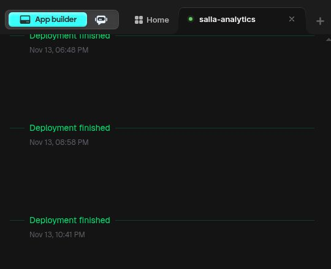

# Operational balances follow-up — release continuation 2026-11-13

<!-- RESUMPTION-CURRENT-START -->
## Current state

PR #1906 is merged and published. Official public verification completed successfully on 13 November 2026 at 19:56:56 UTC (22:56:56 Riyadh): actual exit 0, `verified:true`, all 3 passes, and final guard status exactly `{"active":false}`. The source A7, intent B7 and normal merge M are unchanged. The new platform version is `72c5b2e`, explicitly completed at 22:41 Riyadh.

Fresh financial acceptance remains unobserved. One intentional reload of the signed-in financial-position page started at `2026-11-13T20:00:53.168Z`, after the release gate closed; visibility was confirmed `visible` immediately after reload. The browser transport disconnected before the next observation, and the environment was explicitly reported unavailable by 20:03:31 UTC. No result of this attempt was read. Do not infer success, failure, POST count or a new snapshot from elapsed time. A saved report from 12 November 01:07 is not accepted as a fresh result.

## Canonical identities

| Item | Exact value |
| --- | --- |
| Production/task PR | https://github.com/AMASI-SA/AMASI-SA/pull/1906 |
| Production branch | `hotfix/prod-snap-meta-final` |
| Source A7 | `286e46ce50d0ae1f5f128646e350bbae38b2ef5c` |
| Intent B7 | `9502be1eb4adfc8f28a33a190cc3a5be8b75e241` |
| Reviewed prior production J | `8d25f7a6fa9a310b319b753c32457e70987f7c51` |
| Normal merge M | `791b019e20ffe24439393576129783cd4c9dceb3` |
| B7 and M exact tree | `663ff410de7bc6e18933ac1d06fcdd4564bd69ba` |
| Intent SHA-256 | `066eafb9d85445f9868b5d12ec853e7c252b00175aa38f425af2f2c18678f4ad` |
| Runtime ID | `rg5-4b111864525e317c313f6358c3c42f5ba2deaa6f1610b6e2db47399029b7a57f` |
| Frontend artifact tree SHA-256 | `f77e96091e737b362accb3c17e2a642081b0fec48fdcbced94ff20672772a4e5` |

This documentation-only handoff branch is separate from the frozen production release. Do not merge it into the A7/B7 deployment contract or publish its HEAD.

## Verified milestones

- Exact A7: all 13 workflows succeeded; 29 checks comprise 23 successes and 6 expected skips.
- Exact B7: all 13 applicable workflows succeeded, plus one branch-specific TikTok workflow skipped; 31 checks comprise 25 successes and 6 expected skips. Final CodeQL Python, JavaScript/TypeScript and aggregate checks succeeded. A temporary comparison warning cleared when Python analysis completed; no rerun or bypass was used.
- Readiness run 43489951555 passed both host rehearsals: Node 20.20.2 job 132108986553 and Node 24.19.0 job 132108986525. Their identity and isolated health/package/runtime artifact proofs matched A7/J/B7.
- Root and independent checks confirmed that B7 changes only `release/release-intent-v5.json` from A7, with the exact reviewed artifact bytes. M has parents J and B7 and exactly the B7 tree.
- All 3 exact-M push workflows and all 11 check runs succeeded, including final CodeQL and both clean-clone rehearsals.
- The original `/app` operator fast-forwarded from exact J to exact M while the guard was inactive. The actual `yarn build` dispatcher/adapter exited 0 with `built:true`; the complete materialized runtime identity matched the reviewed intent.
- Tracked files remained clean. All 120 pre-existing untracked-file content hashes were preserved. Inventory digest: `711375f165d96827e4c1e5596967686ef05ae7c976571b9a8aeeede5e8c368db`. Existing worktrees and the unsaved editor were preserved; no cleanup or reset was used.
- Official prepare exited 0 for actor `arafat-pr1906-b7-terminal` at `2026-11-13T19:29:50.254295+00:00`. Official prepublish exited 0 with `ready_to_publish:true` and exact A7/M/runtime.
- One Publish changes action was submitted. The platform explicitly completed version `72c5b2e` at 22:41 Riyadh. Use version/time; the retained ordinal shifted, so do not infer a publication count.

## Official public verification

[Exact official verification JSON](OFFICIAL-RELEASE-VERIFICATION-20261113.json) is preserved byte-for-byte from the original operator: 33,299 bytes, SHA-256 `c756f0b20cbd728f64df6b0ff6d54a8eb5991fed9c4430e9b1cabe5598d692b0`. [Execution metadata](OFFICIAL-RELEASE-VERIFICATION-METADATA.json) records the real exit and final guard status.

- Actual exit: 0; stderr: 0 bytes.
- `verified:true`, `checks:3`; exact source A7, deployment M, runtime and frontend artifact identity.
- 582 frontend requests per pass, 1,746 across the three passes, plus 3 health checks.
- Full public file bytes/hashes, shell routes, service workers and build-meta JSON/MIME checks passed. This does not mean every frontend request was a MIME check.
- Boot observations: `2026-11-13T19:41:24.060844+00:00` and `2026-11-13T19:40:48.045792+00:00`, both after prepare.
- Wrapper elapsed time: 822.87 seconds.
- Final official status: exactly `{"active":false}`. No active or incomplete lease remains.

No further Publish, prepare or verify command is needed for this release.

## Remaining live acceptance

The release is fully verified and the guard is closed. Only application-level acceptance remains. When browser access returns, inspect the existing financial-position tab first; do not blindly reload or publish again. The last observed pre-reload page still showed the saved 12 November 01:07 snapshot and timeout fallback. The post-reload result was never observed because the execution/browser environment became unavailable. No financial confirmation, settlement or payout was attempted.

Accept only a new report `as_of` / “آخر احتساب” without `refresh_warning`; `generated_at` is merely report rendering time and may be new even with an old snapshot. Capture the existing refresh outcome if it remains accessible, then inspect pending-order numbers/reasons and idle labels. If the existing page cannot yield a result and a new attempt is necessary, make one intentional visible attempt after checking that no refresh is still active. A genuine incomplete-evidence warning is separate from failed refresh.

The pending-order dialog has not yet been checked on the new live release. After the sequence settles, inspect its numbers, reasons, paging/search and the absence of false idle “جارٍ التحقق وحفظ التأكيد…” labels. Opening the dialog is read-only. Do not click confirmation buttons: they may write immediately after successful preview.

Do not switch tabs during an unfinished refresh/report GET: hiding the tab cancels it and returning may resume a new attempt. After settled success or fallback, hide/show should not trigger another calculation. No additional live refresh is needed solely to repeat cancellation cases already covered by tests. Claims about live cancellation require fresh runtime evidence and must not imply individual Mongo operations were interrupted.

No real confirmation, settlement, payout, advertising or other financial test write is authorized. Issue #1006 is at its comment cap; PR #1902 and PR #1906 remain the continuation threads. No paid Emergent chat/Copilot was used.


<!-- RESUMPTION-CURRENT-END -->

## Historical frozen A7 source record

The following record describes the source checkpoint before this resumed release. Its old pending/lease states are historical; use the current state above for continuation.


### Current state

The corrected source is locally verified and independently reviewed after A5
failed consumer read-shape contracts and A6 missed the actual application DB
adapter. Both have narrow corrections with regression coverage. Exact-source CI and a
new reviewed v5 source/intent pair are still required. No intent has been
committed. This source is not merged or deployed. Fresh financial acceptance
remains FAILED; no synthetic result is treated as production acceptance.

### Repository and continuity

- Repository: `AMASI-SA/AMASI-SA`.
- Task branch: `codex/operational-live-refresh-followup-20261113`.
- Draft PR: https://github.com/AMASI-SA/AMASI-SA/pull/1906.
- Base Production: `8d25f7a6fa9a310b319b753c32457e70987f7c51`.
- Initial remote UI WIP: `eb0017ecdb10dc7ab17b27e748f2b0d86532b44b`.
- Rejected source A5: `f5a764999b6e902882d1f7b4fe8a7b951af4ecc1`.
- CI-green but superseded source A6: `41623632b2531e44aa592c06e52bd66b1c6a7b38`.
- Root owns integration and the already-authorized release operation.
- The exact next source SHA is recorded in the PR continuation entry; this
  document cannot contain its own commit identity.
- Issue1006 has reached its comment limit. PR1902 and PR1906 are the linked
  continuation threads. No coordination marker exists; no board was created.

### Completed behavior

#### Pending-order dialog

An idle row without valid confirmation metadata could display the busy label
because both target key and busy key were null. The display now requires a
non-null busy key. The order number and reason remain visible; opening the
modal does not call preview or confirmation. A real explicit request still
shows its busy label until completion. Eligibility, permissions and saved
proof semantics are unchanged.

#### Bounded cost reads

- Within the positively admitted visible-request path only, do not query units
  when no matching plans exist: `plan_id: {$in: []}` can only return an empty
  set. Default callers retain even that empty query as part of their existing
  audited read contract.
- The remaining-bundle adapter explicitly opts into overlapping three
  independent reads: stored snapshots, lifecycle and plans.
- The authority permits this only for exact raw `AsyncIOMotorDatabase` or the
  exact application `AcceptanceConfigDatabase` directly wrapping exact raw
  Motor. The current `DemandRefreshContext` must own the same ORIGINAL DB
  identity and owner, and `require_connected()` must succeed. All queries
  continue through the original adapter; its underlying DB is inspected only
  to prove this narrow admission. It is not used to bypass the adapter.
- Default callers, all other wrappers/session adapters, mismatched owner/DB and
  calls outside that context remain serial and retain their exact read shape.
  Ordinary financial GET receives neither optimization.
- Results and errors are awaited in the previous source order. Failure or
  cancellation cancels and joins all started children; repeated cancellation
  cannot detach them. At most three authority reads are active at once.
- The full order cohort, original source limits, financial holds, monetary
  rules, deadlines, authorization and explicit confirmation are preserved.
  No scheduler, polling, hidden loading or background refresh was added.

The proposed historical-only cohort filter was rejected. Actual-module
synthetic reproduction showed that a newer order's frozen bundle evidence can
prevent incorrectly pricing an older order from its profile. The old filter
removed that hold. `operational_open_cost_exposure.py` is unchanged; the
regression preserving the hold is retained in the new test suite.

### Source files

- `backend/order_cost_authority.py`
- `backend/operational_remaining_bundle_sources.py`
- `backend/tests/test_operational_balance_cost_read_scope.py`
- `frontend/src/pages/operational/PendingOrdersDialog.jsx`
- `frontend/src/pages/operational/PendingOrdersDialog.test.jsx`
- `scripts/testing/operational_refresh_stage_analysis/measure_cost_authority_reads.py`
- This status and `COST-READ-MEASUREMENT.jsonl`.

No manifest, lockfile, release guard or frozen prior release intent was changed.
All fixtures and measured monetary values are synthetic. No live customer,
order, party, financial data or credentials are included in this public record.

### Completed verification

Backend command (repository root, isolated repository-pinned test dependencies):

```bash
PYTHONDONTWRITEBYTECODE=1 PYTHONPATH=backend:backend/tests python -B -m pytest \
  --noconftest -q --tb=short --maxfail=3 \
  backend/tests/test_operational_balance_cost_read_scope.py \
  backend/tests/test_order_cost_authority.py \
  backend/tests/test_operational_open_cost_exposure.py \
  backend/tests/test_operational_balance_sources.py \
  backend/tests/test_marketing_bundle_cost_authority.py::test_marketing_deduplicates_before_one_batched_authority_load
```

Exit0: **214 passed in22.12s**, including35 new cases and the4 cases that failed
in A5's G47 gate. They cover full-cohort
financial evidence, result parity, units with/without plans, all wrapper and
owner/DB boundaries, read limits, error precedence, disconnect and repeated
cancellation with no remaining tasks. Initial import failures from missing
local test dependencies were resolved within the task venv before this pass;
no test expectations were weakened.

Frontend command:

```bash
CI=true python -B scripts/frontend_release_toolchain.py exec -- \
  yarn --cwd frontend test --watch=false --runInBand --resetMocks=false \
  --runTestsByPath src/pages/operational/PendingOrdersDialog.test.jsx
```

Exit0: **33 tests /1 suite passed**, no skips/failures; Jest8.887s. The pinned
Node22.23.2/Yarn1.22.22 bootstrap and single frozen-lockfile install passed.
The three new cases cover absent/malformed metadata and genuine in-flight
confirmation. The original defect was established live and in source; no
pre-fix automated red run was claimed. Package and lockfile diffs are empty.

Root reviewed the combined application diff and `git diff --check` passed.
An independent reviewer signed off the exact backend hashes below, after
checking context gates, serial fallbacks, ordering, cancellation/join and the
unchanged full cohort. That was an independent source review, not a second
execution of the214 tests or a production performance claim.

| File | SHA256 |
|---|---|
| order_cost_authority.py | `cb806ffd2dbdf48ab83bb267326e9b9cc90c5dbf2dcc19b12ae15880d3ec2f47` |
| operational_remaining_bundle_sources.py | `911ebd5bce96a6ff05f12f2d3a8992e58c9ec396868a3f0fbfad8501ec7be2bf` |
| test_operational_balance_cost_read_scope.py | `2fb258b045b2a70636c8aa4ad4548b3e00e6615a9caf6085c2c6393e1715f949` |
| PendingOrdersDialog.jsx | `aeb6d1faa6aaf360f9ec1b1700e68e6382024de7551be473a174fadc7441a831` |
| PendingOrdersDialog.test.jsx | `6a723434f4f7a9e35ec33f9c48c7bde60562a80a8197963d1e3c22e50a536843` |

### A5 integration rejection and correction

All13 exact-A5 workflows ended:9 passed and4 failed. The blocked gates were
G47 `43472485532`, Dashboard runtime `43472485297`, Operational Balance Web
`43472485539`, and Stock `43472485381`. No failure was called a flake or an
unrelated pre-existing defect, and no failed run was rerun or bypassed.

The empty-plan UNITS omission had been global in A5. G47 expected6 authority
collections but received5. Dashboard passed its first frozen JSON comparison,
then rejected the missing audited UNITS command and stopped at that case.
Operational and Stock repeated the2 mapping cases expecting8 reads but seeing7;
their preceding completeness and monetary-total assertions passed. The original
read-shape assertions remain unchanged.

The corrected condition is `if plans or not parallel_reads else []`, using
the already-validated positive request gate. Three new tests prove the default,
explicit false and invalid truthy opt-in retain their empty UNITS read. Existing
wrapper/no-context/owner/DB mismatch tests now also assert their original query.
Local198 cases passed, including all4 G47 failures. The2 actual-Mongo mapping
cases were not run locally because no isolated Mongo exists in this scratch
environment; exact corrected-source CI must run them and the complete frozen
Dashboard gate. No existing service or real data was used for local tests.

A5's own16 new backend cases passed in its3783-case JUnit result, while2
compatibility cases failed. Its frontend artifact proved721/721 and all33
dialog cases passed. These are historical A5 results, not acceptance of the
corrected source. A6's backend scope suite had19 cases; the current suite has35.

A5 candidate artifact14061806909 passed official candidate validation, but
was NOT committed as an intent or used for publication. It is obsolete for
the corrected source. A new source/intent identity must be built and verified.

### A6 CI closure and production-adapter correction

At17:42:37UTC all13 exact-A6 workflows passed:29 checks were23 successful plus6
expected scope/source-role skips, with0 failures. Independent artifact parsing
proved Operational3786/3786 including all19 scope cases and both previous
mapping failures, frontend721/721 and dialog33/33, G47 cost436/436 including
the4 previous failures, and Dashboard runtime/reference/production baseline
40/40 each plus255 regression cases. Frozen expectations and workflows stayed
unchanged. Principal runs: Operational `43474371783`, G47 `43474371880`,
Dashboard `43474371676`, Stock `43474371993` and Readiness `43474371624`.

Before freezing any intent, root traced `server.py:208` and the operational
router binding: the app injects `AcceptanceConfigDatabase(raw Motor)`. A6's
raw-only type gate would therefore leave the optimization inactive in the real
application. The validated A6 candidate14063260084 was not committed or used
for publication. It cannot represent this corrected source.

The current narrow gate admits only that exact, session-free repository adapter
over immediate exact raw Motor, preserving the original request DB identity
and every query through the adapter. New cases use the actual adapter to prove
activation, financial parity, original-adapter query delegation, default/GET
serial reads, wrong owner/context/DB rejection, nested snapshot/private-wrapper
and subclass rejection, and joined cancellation including repeated cancellation.
Root and an independent reviewer signed off the current hashes above. All214
local cases passed; the current35 scope cases and full regressions still require
new exact-source CI and a newly built intent.

### Reproducible synthetic measurement

The tracked measurement script runs the actual `run_visible_refresh` and
`collect_sources` modules through the actual `AcceptanceConfigDatabase` adapter
over in-memory Motor boundaries, with10ms artificial cursor latency. Both old
and new implementations use that same application adapter. It makes no
external DB call. Root ran the saved script
successfully and preserved its exact JSONL output alongside this document.

```bash
PYTHONDONTWRITEBYTECODE=1 PYTHONPATH=.:backend:backend/tests python -B \
  scripts/testing/operational_refresh_stage_analysis/measure_cost_authority_reads.py
```

| Orders | Source reads before/after | Authority peak before/after | Original A5 raw-only ms before/after | Current actual-adapter ms before/after |
|---:|---:|---:|---:|---:|
| 1,000 |50 /46|1 /3|1185.941 /860.838|1219.543 /1043.727|
| 5,000 |114 /94|1 /3|3304.317 /2343.424|2798.257 /2120.663|

All runs assert exact financial/source result equality, unchanged inputs,
unchanged2 lease operations and0 remaining tasks. The result digests match
between runs. Timing varies with the local environment; the deterministic
read-count reduction and parity are the mechanism evidence. This is not a
measurement of production latency or proof that its timeout is resolved.
An intermediate A5 reproduction measured1908.545/1183.308ms and
3537.936/3155.214ms. A6's raw-only sample measured1122.270/840.167ms and
2301.399/2607.518ms: its5000-order candidate was slower despite fewer reads;
there is no guaranteed elapsed-time improvement claim. Do not repeat samples
to select a favorable timing. The corrected source preserves the optimization
only on its admitted visible path, and preserves all default query contracts.

### Live evidence and previous release

PR1902 source `1f8f1d673854f594086a6e87dec6c98633da0061`, deployment
`b64121c265d8d6e158df0d9fb88debc52c95317d`, is officially verified live.
The original operator completed the official verification2026-11-13 at
17:02:16UTC: exit0, three full passes,582 frontend requests per pass.
Subsequent official status returned `active:false`. Platform completion is
Nov13,18:48Riyadh, version0cdd01a. Do not republish that frozen pair.

The authenticated report displays saved balances and pending-order modals with
working pagination. Its initial visible refresh failed with a source-read
message; two manual diagnostic attempts used the refresh-timeout fallback.
A saved financial GET was observed status200 with duration31839.360ms.

A fourth total attempt was justified after Management returned a newer log
window. It started17:18:00.027UTC and remained visibly open; by17:20:20UTC it
again showed the refresh-timeout fallback. Log retrieval then remained cached
at17:17:23 despite navigation/reload, so no corresponding phase timing was
captured. A later operator status revealed another task had prepared a release
at17:17UTC, so this fourth attempt overlapped that release and is not a stable
runtime acceptance result. Do not infer a single production bottleneck or
repeat blind refreshes before a concrete change. No real confirmation,
settlement or payout was clicked.

Prior release evidence remains on documentation-only branch
`codex/operational-delivery-release-handoff-20261113` at
`e1eb7af40d5604a77b93f92f8dfaa071c8b660d4`, linked from PR1902.

#### Other operator lease now active

Fresh read-only status positively returned an active protocolv5 lease owned by
`arafat-pr1905-terminal`, prepared `2026-11-13T17:17:00.403406+00:00`, source
`c05108b41a3cb603955b210acb0fba32743d5d5f`, deployment
`8d25f7a6fa9a310b319b753c32457e70987f7c51`, runtime
`rg5-9f65056bf0d9f1bc5e40da895de78a8288fee5e532ecaaa26daf4f468522894b`.
This is not the closed PR1902 lease and is not owned by this follow-up. Do not
clear, reuse or verify it on behalf of this task. Preserve its operator state
and Production head until its owner closes it and fresh status is inactive.

### Next safe action

1. Preserve the corrected source checkpoint on this task branch and inspect all
   exact-source CI results, including the new35 cases and every previously
   failed compatibility gate. Do not use either A5 or A6 candidate intent.
2. Recheck current Production. Freeze a new reviewed intent-only commit after
   the clean governed build; do not squash/rebase or add source after freezing.
3. Complete exact intent gates and clean-clone rehearsals. Wait for the other
   lease's owner to close it before changing Production or the operator. Read fresh
   operator guard/coordination, HEAD and tracked/untracked state before any
   operator mutation. The prior closed lease must not be reused.
4. Use the owner's existing upload/merge/publish authorization and protocolv5.
   Require a newer explicit platform completion and official full verification.
5. Inspect the live report without real financial confirmations. Financial
   acceptance requires a fresh successful report, not a dated fallback.

New task Production changed: **NO**. No new operator source mutation, lease or
Publish action has occurred at this source checkpoint. Preserve unrelated
Production8d25 work, operator untracked files and unrelated terminals.
