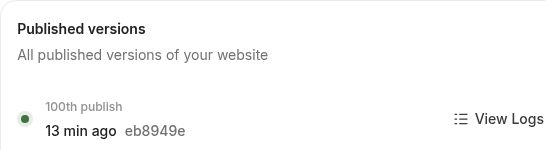

# Support performance recovery — production verified

Updated after successful verification observed by **2026-11-11 16:33:11 UTC / 19:33:11 Asia/Riyadh**.

## Outcome and owner scope

**Merged, published once, and verified on https://mezansalla.com.** The unchanged Release Guard returned `verified: true`, `checks: 3`, the exact reviewed source/deployment/release identity, and the expected frontend artifact tree. The follow-up guard status returned **`active: false`**.

The owner explicitly authorized merge and publication. Secure in-conversation browser authentication completed successfully; no credential value was exposed. Preparation-file creation was excluded by the owner. All eleven existing preparation files remain byte-identical to the reviewed production base.

This record is on an **evidence-only branch**. Do not deploy this branch. The frozen release source and intent were not changed after acceptance. The status document baked into source A is a historical pre-publication checkpoint; this record supplies the final production outcome.

## Immutable release identity

| Item | Accepted value |
| --- | --- |
| Final PR | https://github.com/AMASI-SA/AMASI-SA/pull/1881 |
| Production branch | `hotfix/prod-snap-meta-final` |
| Reviewed prerequisite/base J | `3f60c1a08263ff1eb2412c0f9224467a198ac278` |
| Source A | `8f11a73a8e53262ed938505f39a141eca3dfab8f` |
| Source A tree | `1ce136cfe6c4bf6f12155b95d547b76767ba52b7` |
| Intent-only B | `173cc5ca7ceae8e50aae3f4bde13e972a2a053bd` |
| B / production tree | `31763cd6cf814f0809376a707c7af2de2ebf23f0` |
| Production merge | `77e687e6964254617b4aa9eb0e3164cc968cff3b` |
| Runtime release ID | `rg5-5dca51b366b459cf1d62df9686fb97ce6385f29b652df7545cfe90270aecb8f8` |
| Protocol | `5` |
| Frontend artifact tree SHA-256 | `8bc4ff27a8d4cedc85d5613789176c0eda9100ad5d7b7538aba33756999d8fdf` |
| Intent SHA-256 | `3b580317093129ae534f26f35b4f213ec5c5d0c934188fc0da07ae93d85ccbbe` |
| Candidate archive SHA-256 | `801bfc6a6ea82f124f676e1b8b1e1a57ed393c2c20e342f7f952d5b8a4c6ec80` |
| Candidate artifact ID | `13867343869` |

The normal final merge has parents J and B and exactly B's tree. Root and independent review confirmed ancestry, the intent-only delta after A, and preservation of all eleven preparation exclusions. No frozen A/B pair was squashed, rebased or force-pushed. No guard, scope gate or allowlist was weakened.

## Implemented behavior

### Campaign AI monitoring and source comparison

Page/status reads return saved results. Monitoring and source comparison are explicit manual jobs. A global runner and an owner admission slot prevent overlapping analysis; building snapshots remain hidden until lease-fenced publication of both the canonical result and cache.

The core performance window is three days. Monitoring has an eight-minute execution limit **per attempt**. The independent comparison accepts a one-to-fourteen-day window with a five-minute execution limit per attempt. These are execution limits, not promises of end-to-end completion time after clicking: queue time, bounded recovery attempts and termination grace are separate. Recommendations do not execute advertising changes. Unrelated advertising data services and independently configured automation remain outside this change.

### Qoyod

Each order's disposition is durably recorded before proceeding. Interrupted audit recovery uses indexed, bounded pages of twenty records and excludes the current owner's active work. Uncertain provider outcomes remain for review rather than being automatically re-sent. No-progress or repeated-result work receives a fifteen-minute cooldown. The normal two-hour automatic sending sequence remains.

Explicit manual sends/retries use durable asynchronous jobs, coalesced admission and lease checks before provider writes. Explicit retry is allowed only for definite pre-write refusals. The full scan is manual.

### Snapchat

The automatic data-refresh interval has a persisted minimum/default of two hours measured from the saved completion of an attempt. Old five-minute settings do not reintroduce the rapid automatic cadence. Explicitly longer settings are preserved; explicit manual refresh remains a separate action, and its saved completion participates in freshness. This is a minimum interval, not an exact wall-clock schedule.

### Preparation files

The eleven preparation exclusions are unchanged. No preparation-file-generation fix is included.

## CI and pre-publication acceptance

Exact B completed **37 successful workflows** with one expected conditional TikTok Creator Release Candidate skip and no failed or pending workflows.

- [Release readiness 43050051800](https://github.com/AMASI-SA/AMASI-SA/actions/runs/43050051800) passed, including actual clean-clone Node 20 and Node 24 adapter rehearsals.
- [Background-worker acceptance 43050052320](https://github.com/AMASI-SA/AMASI-SA/actions/runs/43050052320) passed 293 backend tests, 48 Salla synchronization tests and 76 frontend tests across five suites.
- [Review Completion 43050051345](https://github.com/AMASI-SA/AMASI-SA/actions/runs/43050051345) passed.
- [Source candidate readiness 43049065057](https://github.com/AMASI-SA/AMASI-SA/actions/runs/43049065057) passed. The downloaded archive digest, source/base bindings, unchanged candidate validator and derived source manifests were verified in a clean worktree.

These are exact-B acceptance results. Three superseded/cancelled source-A runs are not counted as successes. Focused regression counts overlap with the named suites.

Prerequisite PR #1880 was merged at J after its unchanged scope gate and Node 20/24 rehearsals passed. PR #1878 is closed as superseded, with its history preserved. An earlier integration tree `ab5dd65afdd7b7b76cd8f2eb8b7eea63d227c223` was rejected by the unchanged full-history intent preflight. The final branch begins at J and applies the identical reviewed implementation; only the status document differs from that intermediate tree.

## Shared workspace and governed rehearsal

The shared workspace guard initially reported `active: false`. Shared AGENTS.md SHA-256 matched the fully read local instructions: `4f32267f74505dc424f7a55af396ca817014d611b0752e0f76832bb1daab5461`. The coordination marker was absent. The tracked worktree was clean, and unrelated untracked files were preserved.

Shared `/app` was fast-forwarded from `f439bed54579fafb79a8abcb43080c8150cb5063` to the exact reviewed production merge. The tree and complete untracked-file list were checked.

The first adapter rehearsal refused prepackaged Backend bytecode before building. Two generated files under `backend/__pycache__` were preserved by rename to:

`/app/.release-preserved/support-performance-20261111/20261111T160011Z/__pycache__`

This is outside all packaged source roots. No tracked source, intent, guard or ignore rule changed. Subsequent shared Python commands used `PYTHONDONTWRITEBYTECODE=1` and/or `python -B`.

The second unchanged `frontend/yarn build` rehearsal passed with exit 0 in **86.38 seconds**, using the exact reviewed public origin. It reported the expected artifact tree and verified an isolated Backend package of 1,172 files without .git or a sibling Frontend: `isolated_verified: true`, `health_verified: true`.

- Materialized identity SHA-256: `3d9e4409c2a2d36eecf12c36533a61ea1ee94c460f8fb78c6fc5fe0b8b786e75`.
- Backend package tree SHA-256: `ca259314dbaa22a533a6ff189eeb26c8a440c7d33e57b59e4133c3cf38e988fd`.
- Shared rehearsal host: Node 24.19.0, Python 3.11.18, Yarn 1.22.22.
- Governed build toolchain: Node 22.23.2, Yarn 1.22.22, Vite 8.2.4.

This is shared rehearsal evidence, not an observed historical Cloud Build command transcript.

## Publication and final live verification

The owned lease was prepared at **2026-11-11T16:04:26.037644+00:00**, actor `support-performance-recovery-20261111`. Unchanged prepublish returned `ready_to_publish: true` for the exact accepted identities immediately before publication.

Root clicked **Publish changes once**. Emergent showed a new start at **November 11, 19:06 Riyadh**, followed by a green **“Deployment finished” at 19:15 Riyadh**. The latest published revision changed from `276cb53` to **`eb8949e`**. The actual UI wording was “Deployment finished”; no literal “Deployment Succeeded” label was captured. The retained history still labels the newest slot “100th publish”, so that label must not be interpreted as a newly measured cumulative count.



The unchanged command ran once:

```text
PYTHONDONTWRITEBYTECODE=1 python -B scripts/production_release_guard.py verify --url https://mezansalla.com
```

It completed successfully. The wrapper asserted `verified: true`, `checks: 3`, exact source A, production merge and release ID, then read and asserted **`active: false`**. The verifier covered the reviewed public frontend files, canonical/cache-busted responses, metadata, shell and service-worker requirements across all three rounds.

- Observed runtime boot: **2026-11-11T16:15:05.027420+00:00**.
- Returned boot observations contained that same single boot timestamp.
- Returned frontend tree matched **`8bc4ff27a8d4cedc85d5613789176c0eda9100ad5d7b7538aba33756999d8fdf`**.
- [Verification summary](verification-summary.json) records the exact narrow JSON projection observed in the terminal and the subsequent inactive guard status. It is a summary, not the full raw guard output.

No second publication or parallel verification was performed. No paid Emergent chat, credit purchase, subscription change or auto top-up was used.

## Read-only live observations and limits

The authenticated advanced dashboard displayed **“تشغيل يدوي · فترة الأداء الأساسية 3 أيام”**, with separate **“تحديث المراقبة”** and **“تحديث المقارنة”** buttons. No analysis or comparison button was triggered. Opening the whole dashboard may read its separately configured realtime widgets; this observation is not proof that every dashboard read avoids every provider.

The Qoyod overview displayed automatic sending as operational and described the two-hour sequence after the previous cycle completes. It showed **754 processed of 773, 102 sent and 651 for review**. One subsequent read-only reload showed the same counters. This proves the displayed state, not progress between observations or reconciliation of all historical audit rows. Its temporary inspection tab was closed afterward.

Public readiness returned exactly `{"ready":true,"phase":"ready"}`. Public health/readiness establish identity and readiness; they do not expose background-worker health, scheduling history or audit cleanup totals.

**Not claimed:** that all 1,087 historical running audit rows have already been reconciled; that the same five orders have been observed across a full post-release cycle without retries; that Snapchat's two-hour interval has been observed over a full interval; or that the previous production latency has been remeasured. Those business/runtime outcomes require subsequent authenticated stored-state observations over time. No invoice send, scan, approval, ad mutation or provider-sync write was used as a test.

## Retained operational artifacts and continuity

Shared capture paths:

- `/tmp/support-performance-20261111-rehearsal.log` — first refusal.
- `/tmp/support-performance-20261111-rehearsal-2.log` — successful rehearsal.
- `/tmp/support-performance-20261111-prepare.json` — owned prepare payload.
- `/tmp/support-performance-20261111-verify.json` — full final guard output.

Earlier checkpoint chronology remains in [the previous evidence revision](https://github.com/AMASI-SA/AMASI-SA/blob/000d4576dd729de96e83ded81b85f809b20f97d5/docs/operations/SUPPORT-PERFORMANCE-RECOVERY-20261111/STATUS.md) and Git history. Issue #1006 is comment-limited; PR #1881 and this tracked record provide continuity.

The authorized merge/publication workflow is complete. No publication lease remains active.
